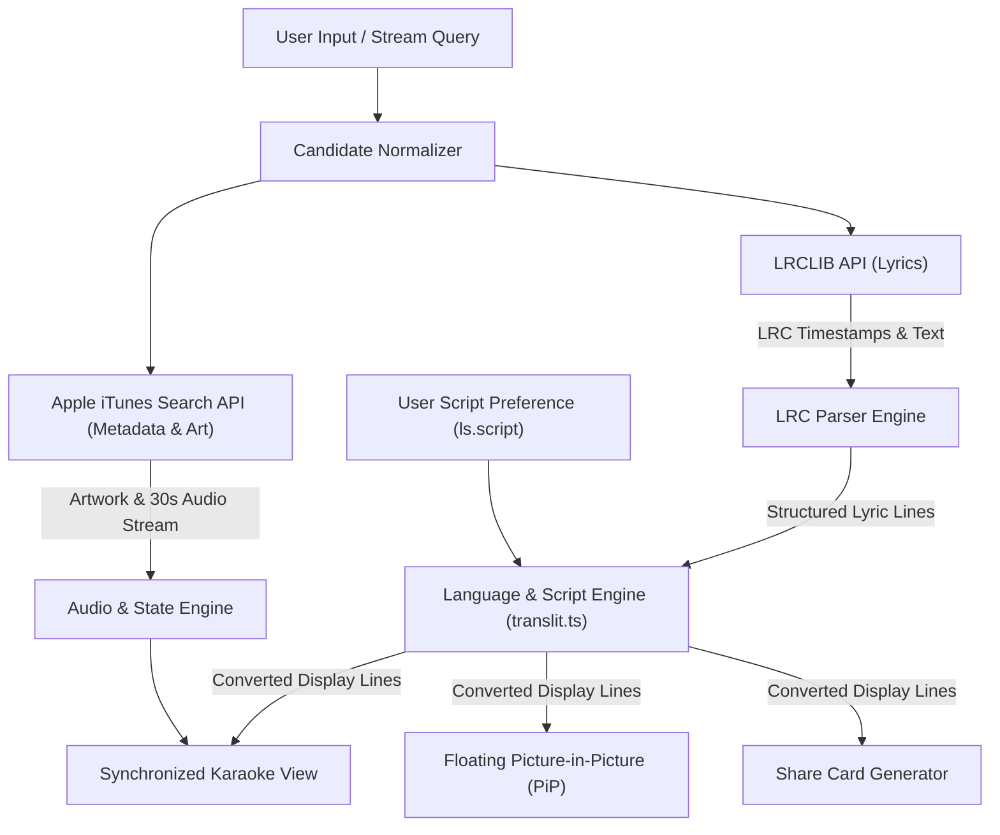
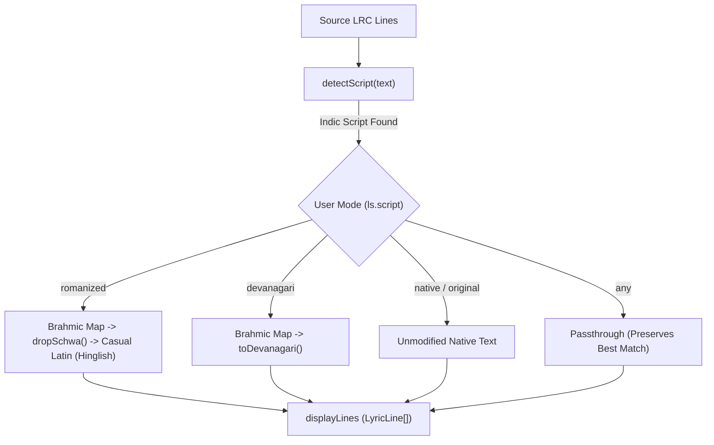
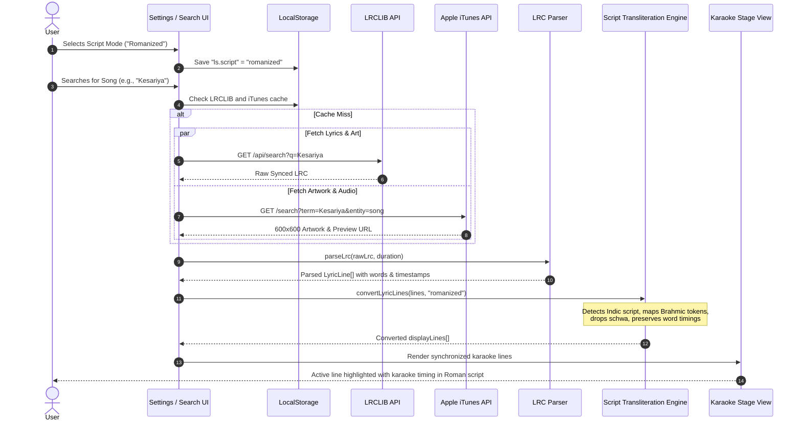

# Lyrics API, Search & Language Switching Implementation Guide

This document outlines the API specifications, query resolution pipeline, lyrics parsing algorithms, language/script switching mechanisms, and client-side synchronization architecture.

---

## 1. Architecture Overview

Lyrics and song details are retrieved via public APIs, parsed into structured timestamps, and converted on-device into the user's preferred script (e.g., Romanized Hinglish or Devanagari) without altering timing:



---

## 2. Lyrics API: LRCLIB

* **Provider:** [LRCLIB](https://lrclib.net) (Free community-driven synchronized lyrics service)
* **Client Implementation:** `src/utils/lrclib.ts`
* **Server Implementation:** `server/index.js`

LRCLIB is the core provider for time-tagged lyrics in LRC format.

### 2.1 Search Endpoint (Fuzzy Text Search)

Used when searching by song title, artist, or generic query string.

* **Method:** `GET`
* **URL:** `https://lrclib.net/api/search?q={query}`
* **Headers:** `User-Agent: LyricSync/1.0.0`
* **Query Parameters:**
  * `q` *(string, required)*: The search query (e.g., `Coldplay Viva La Vida` or `Arijit Singh Kesariya`).

#### Example Request:
```http
GET https://lrclib.net/api/search?q=Arijit+Singh+Kesariya HTTP/1.1
Host: lrclib.net
User-Agent: LyricSync/1.0.0
```

#### Response Structure:
```json
[
  {
    "id": 512344,
    "name": "Kesariya",
    "trackName": "Kesariya",
    "artistName": "Pritam, Arijit Singh",
    "albumName": "Brahmastra",
    "duration": 268.0,
    "instrumental": false,
    "plainLyrics": "Kesarīyā terā ishq hai piyā\nRañg jā'ūñ jo maiñ hāth lagā'ūñ...",
    "syncedLyrics": "[00:15.20] <00:15.20> Kesarīyā <00:16.10> terā <00:17.30> ishq <00:18.10> hai <00:18.90> piyā\n[00:20.40] <00:20.40> Rañg <00:21.00> jā'ūñ <00:21.70> jo <00:22.20> maiñ <00:22.80> hāth <00:23.50> lagā'ūñ..."
  }
]
```

### 2.2 Direct Get Endpoint (Exact Match)

Used when exact song title, artist, and track duration are already known (e.g., from an audio file's ID3 tags or an external stream).

* **Method:** `GET`
* **URL:** `https://lrclib.net/api/get`
* **Query Parameters:**
  * `track_name` *(string, required)*: Song title.
  * `artist_name` *(string, required)*: Performing artist.
  * `duration` *(integer, optional)*: Duration in seconds for precise matching.

#### Example Request:
```http
GET https://lrclib.net/api/get?track_name=Crazy+Glue&artist_name=Josh+Woodward&duration=175 HTTP/1.1
Host: lrclib.net
User-Agent: LyricSync/1.0.0
```

---

## 3. Song Details & Artwork API: Apple iTunes Search

* **Provider:** Apple iTunes Search API (Free public directory)
* **Client Implementation:** `src/utils/itunes.ts`

While LRCLIB provides the lyric timestamps, Apple's iTunes Search API supplies official metadata, high-resolution album covers, and audio previews.

### 3.1 Search Endpoint

* **Method:** `GET`
* **URL:** `https://itunes.apple.com/search?term={query}&entity=song&limit=10`

#### Example Response:
```json
{
  "resultCount": 1,
  "results": [
    {
      "trackId": 11223344,
      "trackName": "Kesariya",
      "artistName": "Pritam & Arijit Singh",
      "collectionName": "Brahmastra (Original Motion Picture Soundtrack)",
      "artworkUrl100": "https://is1-ssl.mzstatic.com/.../100x100bb.jpg",
      "trackTimeMillis": 268000,
      "previewUrl": "https://audio-ssl.itunes.apple.com/.../preview.m4a"
    }
  ]
}
```

### 3.2 High-Resolution Artwork Transformation

iTunes returns `artworkUrl100` (100×100 px). The application upgrades the image resolution to 600×600 px using string replacement:

```typescript
const artworkUrl600 = item.artworkUrl100 
  ? item.artworkUrl100.replace('100x100bb', '600x600bb') 
  : '';
```

---

## 4. Query Sanitization & Candidate Extraction

Raw song titles from media sources (YouTube, SoundCloud, local filenames) frequently contain extra noise that causes lyric API searches to fail (e.g., `"Kesariya - Brahmastra (Official 4K Video) | Ranbir, Alia | Pritam, Arijit"`).

The application runs a candidate extraction algorithm before querying LRCLIB:

```typescript
function extractSongCandidates(rawTitle: string, channelOrArtist?: string) {
  const candidates = [];

  // 1. Strip common video/audio suffixes and noisy tags
  let cleaned = rawTitle
    .replace(/\s*[\(\[]\s*(official\s*(music\s*)?video|official\s*audio|video\s*song|full\s*song|song|visualizer|lyric\s*video|hd|4k|remastered|audio|explicit)\s*[\)\]]/gi, '')
    .replace(/\s*[\(\[]\s*(feat\.|ft\.)[^\)\]]+[\)\]]/gi, '')
    .trim();

  // 2. Split on common delimiters: '-', '–', '|', '•', '/', ':'
  const chunks = cleaned
    .split(/[\s\t]*[|•\/\-–—:][\s\t]*/)
    .map(s => s.replace(/@\w+/g, '').trim())
    .filter(Boolean);

  if (chunks.length >= 2) {
    // Try both [Title, Artist] and [Artist, Title] permutations
    candidates.push({ title: chunks[0], artist: chunks[1] });
    candidates.push({ title: chunks[1], artist: chunks[0] });
    if (chunks.length >= 3) {
      candidates.push({ title: chunks[0], artist: chunks[2] });
    }
  }

  if (chunks.length > 0) {
    candidates.push({ title: chunks[0], artist: channelOrArtist || '' });
    candidates.push({ title: chunks[0], artist: '' });
  }

  candidates.push({ title: cleaned, artist: channelOrArtist || '' });
  return candidates;
}
```

---

## 5. LRC Parsing & Word-Level Timing

* **Implementation:** `src/utils/lrcParser.ts`

### 5.1 Supported Formats

1. **Standard Line-level LRC:**
   ```text
   [00:13.50] I used to rule the world
   [00:17.00] Seas would rise when I gave the word
   ```
2. **Enhanced Word-level LRC (Karaoke mode):**
   ```text
   [00:03.32] <00:03.32> It's <00:03.65> a <00:03.80> funny <00:04.20> thing <00:04.50> about <00:04.80> love
   ```

### 5.2 Parsing Algorithm

The parser processes lines sequentially:
1. **Metadata Tags:** Extracts header tags (`[ti:Title]`, `[ar:Artist]`, `[al:Album]`, `[offset:+200]`).
2. **Timestamp Normalization:** Converts bracketed timestamps `[mm:ss.xx]` into seconds:
   $$\text{timeInSeconds} = \text{minutes} \times 60 + \text{seconds}$$
3. **Word Timing Interpolation:**
   * If explicit `<mm:ss.xx>` word tags exist, individual word start and end offsets are recorded.
   * If only line timestamps exist, line duration is computed from the next line's timestamp:
     $$\text{lineDuration} = \min(\text{next.time} - \text{current.time}, 10.0)$$
     Word timings are estimated based on character length proportions:
     $$\text{wordDuration} = \max\left(0.2, \text{lineDuration} \times \frac{\text{wordLength}}{\text{totalChars}} \times 0.9\right)$$
4. **Interlude Detection:** Gaps exceeding 6 seconds between consecutive lines are marked with `isInterlude: true` to display an animated instrumental bridge indicator.

---

## 6. Language & Script Switching Engine (Transliteration)

* **Implementation:** `src/utils/translit.ts`
* **State Management:** `src/App.tsx`
* **User Controls:** `src/components/modals/SettingsModal.tsx`

LyricSync features an on-device transliteration engine that converts Indic scripts (Hindi, Punjabi, Tamil, Telugu, etc.) into the reader's preferred script in real time **without mutating timing or synchronizations**.



### 6.1 Transliteration Modes

Users select their preferred script mode in the Settings Modal:

| Mode Identifier | UI Option Label | Behavior |
| :--- | :--- | :--- |
| `romanized` *(Default)* | **Romanized (Hinglish)** | Converts Indic scripts into natural phonetic Latin text (e.g., `तू है तो` → `Tu hai to`). |
| `devanagari` | **Devanagari (हिन्दी)** | Converts non-Devanagari Indic scripts (Tamil, Punjabi, Telugu, etc.) into Devanagari Hindi script. |
| `native` | **As published** | Retains the exact script published in the source lyric file without transformation. |
| `any` | **Best timing, any script** | Prioritizes timing accuracy over script uniformity; passes original text. |

### 6.2 Supported Indic Scripts

The engine detects Unicode script blocks and supports bidirectional mapping across:

| Script Name | Unicode Range | Key Characteristics Handled |
| :--- | :--- | :--- |
| **Devanagari** | `U+0900` - `U+097F` | Full vowel/consonant matrix, nuktas (`क़`, `ख़`, `ग़`, `ज़`), virama (`्`), anusvara (`ं`) |
| **Gurmukhi (Punjabi)** | `U+0A00` - `U+0A7F` | Addak gemination mark (`ੱ` consonant doubling), tippi, bindi |
| **Tamil** | `U+0B80` - `U+0BFF` | Aytham (`ஃ`), special Dravidian retroflexes (`ழ`, `ற`, `ன`) |
| **Telugu** | `U+0C00` - `U+0C7F` | Vowel signs, pollus, retroflex consonants (`ఱ`, `ఴ`) |
| **Kannada** | `U+0C80` - `U+0CFF` | Consonantal conjuncts and vowel marks |
| **Malayalam** | `U+0D00` - `U+0D7F` | Chillu characters and vowel matras |
| **Bengali** | `U+0980` - `U+09FF` | Assamese/Bengali conjuncts and vowels |
| **Gujarati** | `U+0A80` - `U+0AFF` | Gujarati character sets and matras |
| **Oriya** | `U+0B00` - `U+0B7F` | Odia vowels, consonants, and signs |

### 6.3 Phonetic Casual Romanization Engine

The romanization algorithm avoids archaic academic IAST diacritics and generates natural, readable lyrics:

1. **Brahmic Token Mapping:** Maps vowels, matras, consonants, and virama into standard phonetic components.
2. **Schwa Deletion (`dropSchwa`):** Drops implicit trailing 'a' vowels in accordance with modern Hindi/Punjabi pronunciation rules (e.g., `कर` becomes `kar`, not `kara`).
3. **Casual Vowel Smoothing:** Normalizes double-vowel notations (`aa` $\to$ `a`, `ee` $\to$ `i`, `oo` $\to$ `u`) for readability.
4. **Selective Token Conversion (English Preservation):** English words embedded inside an Indic line (e.g., `"Mera dil love you bole"`) are detected via `INDIC_CH.test(tok)`. Non-Indic tokens remain unaltered.

### 6.4 Timestamp Preservation Guarantee

Transliteration operates via `convertLyricLines(lines, translitMode)`. It iterates through each line and word, replacing only the string `text` property:

```typescript
const out: LyricLine = {
  ...originalLine,
  text: cLine.text,
  // Timestamps remain strictly untouched
  start: originalLine.start,
  end: originalLine.end,
  words: originalLine.words?.map((w, idx) => ({
    ...w,
    text: cLine.words ? cLine.words[idx].text : w.text,
    start: w.start, // Preserved exact audio synchronization
    end: w.end,     // Preserved exact audio synchronization
  }))
};
```

### 6.5 Performance Optimization (`useMemo`)

Transliteration is computed once per song load or script change in `src/App.tsx`:

```typescript
// Memoized converted display lines
const displayLines = useMemo(() => {
  return convertLyricLines(lines, translitMode);
}, [lines, translitMode]);
```

These memoized lines are passed to `LyricsView`, `FloaterPip`, and `ShareModal`, eliminating redundant conversions during 60 FPS playback re-renders.

---

## 7. Client Caching & Storage Strategy

| Storage Key | Storage Engine | Purpose |
| :--- | :--- | :--- |
| `ls_lrc_cache:search:{query}` | Browser `localStorage` | Caches top 20 LRCLIB search responses. |
| `ls_lrc_cache:get:{title}:{artist}` | Browser `localStorage` | Caches full track lyrics and synchronization tags. |
| `ls_itunes_cache:search:{query}` | Browser `localStorage` | Caches artwork URLs and 30-second audio previews. |
| `ls.script` | Browser `localStorage` | Persists user language/script preference across sessions. |
| `lyricsync_db` (`projects`) | IndexedDB (`idb`) | Persists custom edited lyrics and user karaoke studio projects. |

---

## 8. End-to-End Sequence Diagram


